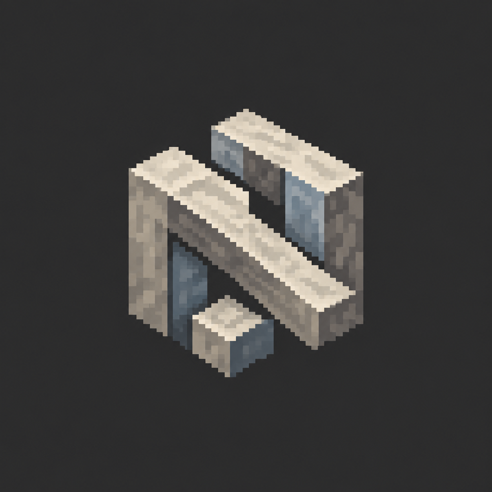
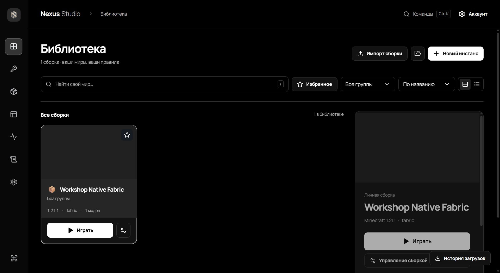
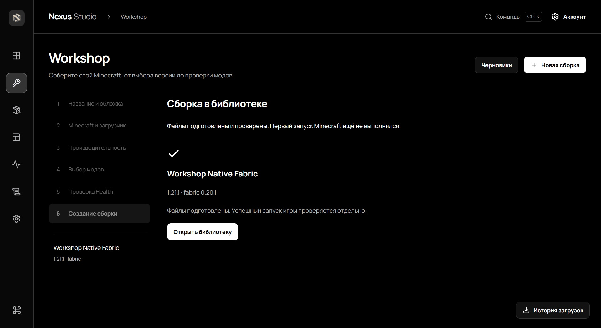

<div align="center">
  
  <h1>NEXUS LAUNCHER</h1>
  <p><strong>Beyond the Worlds</strong></p>
  <p>2.2.0 — The Workshop Update</p>
  <p>
    
    
    
  </p>
  <p>
    <a href="https://github.com/pardonte2-netizen/-Nexus-Launcher/releases/tag/v2.2.0"><strong>Скачать Nexus Launcher 2.2.0</strong></a>
    · <a href="README_EN.md">English</a>
    · <a href="https://github.com/pardonte2-netizen/-Nexus-Launcher/issues/new/choose">Сообщить об ошибке</a>
  </p>
</div>

> **Предупреждение Windows:** установщик не подписан сертификатом Authenticode. SmartScreen может показать предупреждение о неизвестном издателе. Перед запуском скачайте файл только со страницы релиза и проверьте SHA-256 по инструкции ниже.

Nexus Launcher объединяет библиотеку сборок Minecraft Java Edition, каталог модификаций, инструменты подготовки сборок и диагностику запуска в одном приложении для Windows.

## Возможности

- **Nexus Studio** — настраиваемое рабочее пространство и библиотека игровых сборок.
- **Nexus Workshop** — мастер создания сборки с выбором Minecraft и загрузчика, модов и предварительной проверкой настроек.
- **Snapshots** — ограниченная история снимков состояния сборки с проверкой целостности и восстановлением.
- **Nexus Share** — предварительный просмотр, экспорт и импорт пакетов Nexus; для пакетов предусмотрены фильтрация личных данных и проверка хешей. Также доступен разбор `.mrpack`.
- **Mod Intelligence** — анализ локальных модов и показ найденных сведений о совместимости. Неполные или неподтверждённые данные остаются неопределёнными.
- **Crash Investigator** — просмотр локальных игровых журналов и диагностической сводки с ограничением чувствительных данных.
- **Nexus Companion Health** — обзор настроек Java и памяти, выводов Mod Intelligence и доступных локальных данных сеанса. Это не измеритель FPS и не синтетическая оценка производительности.
- **Task Center** — ход и история фоновых операций.
- **Cinematic Launch** — экран запуска с отображением текущего состояния.
- **Vanilla, Forge, Fabric, NeoForge и Quilt** — варианты загрузчиков доступны в приложении; проверенные конфигурации и ограничения перечислены ниже.

## Скриншоты

Снимки ниже сделаны в настоящем приложении. Подписи и содержимое примеров сборок показывают тестовые данные.

<p align="center"></p>
<p align="center"><em>Nexus Studio — библиотека сборок.</em></p>

<p align="center"></p>
<p align="center"><em>Nexus Workshop — завершение подготовки тестовой сборки.</em></p>

Установщик также содержит реальные экраны Setup: [стартовый экран](assets/setup-welcome.png) и [сцена обзора](assets/screenshots/setup-showcase.png).

## Установка

1. Откройте [релиз Nexus Launcher 2.2.0](https://github.com/pardonte2-netizen/-Nexus-Launcher/releases/tag/v2.2.0) и скачайте `NexusSetup.exe`.
2. При необходимости скачайте рядом `NexusSetup.exe.sha256` и сравните хеш. В PowerShell выполните:

   ```powershell
   Get-FileHash .\NexusSetup.exe -Algorithm SHA256
   ```

   Ожидаемое значение: `b9b92c665fa34143c9eb5569a2537abf3313968e4099f07fe586c526b9b87949`.

3. Запустите установщик и выберите папку установки. Если WebView2 отсутствует, Setup предложит установить компонент Microsoft при наличии подключения к интернету.
4. Запустите Nexus Launcher из меню «Пуск» или с экрана завершения установки.

Хеш SHA-256 подтверждает целостность загруженного файла, но не является цифровой подписью издателя.

## Системные требования

- Windows x64.
- Интернет для загрузки игровых файлов, содержимого каталога и WebView2, если он отсутствует.
- Учётная запись и право на Minecraft Java Edition, необходимые выбранному способу запуска.
- Свободное место для лаунчера, игровых файлов, модов и миров. Объём зависит от выбранных версий и содержимого.

Релиз проверялся на одном компьютере с Windows 11 24H2 x64. Другие редакции и сборки Windows, устройства ARM, разные видеокарты и длительные игровые сессии не образуют проверенную матрицу совместимости.

## Платформы

| Платформа | Статус |
| --- | --- |
| Windows x64 | Установщик этого релиза; проверен на одном компьютере с Windows 11 24H2 x64 |
| Windows ARM64 | Сборка не включена; совместимость не проверялась |
| macOS и Linux | Сборки не включены в этот релиз |

## Поддерживаемые загрузчики и объём проверки

| Загрузчик | Проверенная конфигурация 2.2.0 | Что проверено |
| --- | --- | --- |
| Vanilla | Minecraft 1.21.1, Java 21 | Запуск, создание и сохранение мира |
| Fabric | Minecraft 1.21.1, Fabric 0.20.1, Java 21, Sodium 0.8.13 | Запуск, создание и сохранение мира |
| Quilt | Minecraft 1.21.1, Quilt 0.20.0-beta.9, Java 21 | Запуск, создание и сохранение мира; без дополнительных модов |
| Forge | Minecraft 1.20.1, Forge 47.4.28, Java 17 | Ручная проверка запуска, входа в мир и сохранения; без сторонних модов |
| NeoForge | Minecraft 1.21.1, NeoForge 21.1.259, Java 21 | Проверена инициализация клиента; загрузка мира не подтверждена |

Эти результаты относятся только к указанным конфигурациям и не гарантируют совместимость с другими версиями игры, модов, оборудования или сетевых сервисов.

## Известные ограничения

- Установщик не имеет подписи Authenticode; SmartScreen может предупредить о неизвестном издателе.
- Первый запуск именно с производственным идентификатором приложения не входил в локальный приёмочный сценарий.
- Для NeoForge проверена инициализация клиента, но не загрузка мира.
- Для Forge и Quilt проверялись ограниченные конфигурации без сторонних модов; широкая матрица модов и версий не проверялась.
- Поддержка разных устройств, длительной производительности и всех сочетаний аккаунтов, загрузчиков и игровых версий не подтверждена.
- Проверенного автоматического обновления лаунчера нет. Устанавливайте новые версии вручную со страницы Releases.
- Nexus Launcher — независимый продукт; он не связан с Mojang или Microsoft и не одобрен ими.

## Частые вопросы

### Почему Windows показывает предупреждение?

Установщик не подписан Authenticode. Скачивайте его только со страницы релиза и сверяйте SHA-256. Не запускайте файл, если хеш не совпал.

### Нужно ли устанавливать Java отдельно?

Требования к Java зависят от выбранной версии Minecraft и сборки. В таблице выше указаны версии Java, на которых проводилась проверка конкретных конфигураций.

### Как обновить лаунчер?

Скачайте установщик новой версии из GitHub Releases и запустите его вручную. Автоматическое обновление не заявляется.

### Что приложить к сообщению об ошибке?

Укажите версию лаунчера, версию Minecraft и загрузчика, последовательность действий и текст ошибки. Журналы прикладывайте только после удаления имён аккаунтов, адресов электронной почты, токенов и личных путей.

## Сообщить об ошибке

Создайте [Bug Report](https://github.com/pardonte2-netizen/-Nexus-Launcher/issues/new/choose). Не публикуйте пароли, токены авторизации, полные конфигурации аккаунта и неочищенные журналы. Сведения о потенциальной уязвимости отправляйте приватно через доступную на странице репозитория форму GitHub Security Advisory.

## История обновлений

Подробности версий — в [CHANGELOG](CHANGELOG.md) и [заметках релиза 2.2.0](RELEASE_NOTES.md).

## Авторские права и лицензирование

Nexus Launcher распространяется как проприетарный бинарный продукт. Публичная страница предназначена для загрузки и использования готового приложения; исходный код продукта здесь не публикуется. Условия для компонентов Nexus приведены в [LICENSE](LICENSE). Сторонние компоненты сохраняют собственные лицензии; см. [THIRD_PARTY_NOTICES.md](THIRD_PARTY_NOTICES.md) и каталог `LICENSES/`.

Minecraft, Mojang, Microsoft и названия сторонних сервисов принадлежат соответствующим правообладателям. Лаунчер не включает Minecraft и не предоставляет лицензию на игру.
