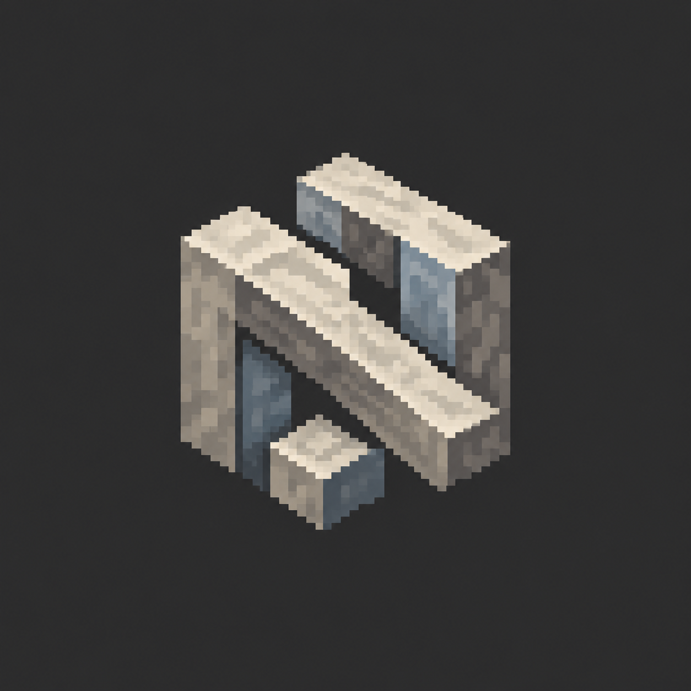
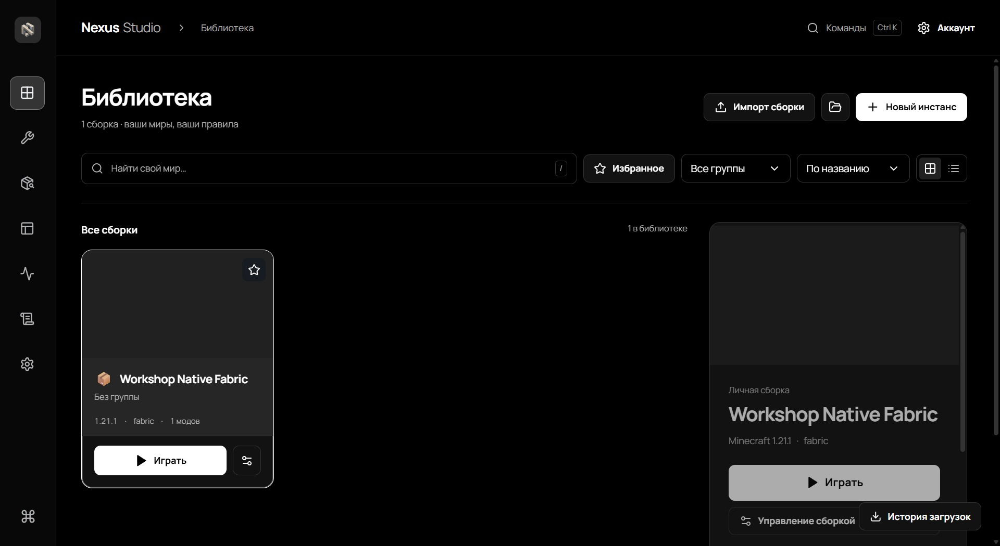
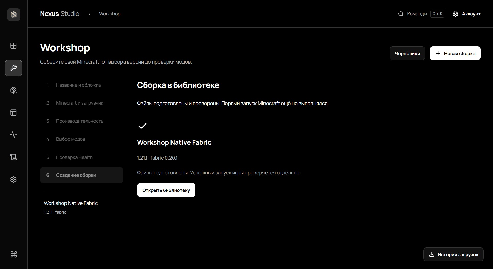

<div align="center">
  
  <h1>NEXUS LAUNCHER</h1>
  <p><strong>Beyond the Worlds</strong></p>
  <p>2.2.0 — The Workshop Update</p>
  <p>
    
    
    
  </p>
  <p>
    <a href="https://github.com/pardonte2-netizen/-Nexus-Launcher/releases/tag/v2.2.0"><strong>Download Nexus Launcher 2.2.0</strong></a>
    · <a href="README.md">Русская версия</a>
    · <a href="https://github.com/pardonte2-netizen/-Nexus-Launcher/issues/new/choose">Report a bug</a>
  </p>
</div>

> **Windows warning:** the installer is not Authenticode-signed. SmartScreen may show an unknown-publisher warning. Download it from the release page and verify its SHA-256 before running it.

Nexus Launcher brings a Minecraft Java Edition library, mod discovery, pack preparation tools, and launch diagnostics together in one Windows desktop app.

## Features

- **Nexus Studio** — a customizable workspace and game-instance library.
- **Nexus Workshop** — a guided pack builder for choosing Minecraft and loader versions, mods, and reviewing setup details.
- **Snapshots** — bounded instance-state history with integrity checks and restore.
- **Nexus Share** — preview, export, and import Nexus packages with privacy filtering and hash checks; `.mrpack` inspection and import are also available.
- **Mod Intelligence** — local mod analysis with evidence-based compatibility details. Incomplete or unconfirmed evidence remains unknown.
- **Crash Investigator** — local game-log inspection and a diagnostic summary that limits sensitive data.
- **Nexus Companion Health** — an overview of Java and memory settings, Mod Intelligence findings, and available local session evidence. It is not an FPS monitor or synthetic performance score.
- **Task Center** — progress and history for background operations.
- **Cinematic Launch** — a launch screen that shows the current launch state.
- **Vanilla, Forge, Fabric, NeoForge, and Quilt** — loader options are available; the verified configurations and limits are listed below.

## Screenshots

These are real captures from the application. The sample instance names and content shown are test data.

<p align="center"></p>
<p align="center"><em>Nexus Studio — instance library.</em></p>

<p align="center"></p>
<p align="center"><em>Nexus Workshop — completed setup for a test pack.</em></p>

Setup screenshots: [welcome screen](assets/setup-welcome.png) and [showcase scene](assets/screenshots/setup-showcase.png).

## Install

1. Open the [Nexus Launcher 2.2.0 release](https://github.com/pardonte2-netizen/-Nexus-Launcher/releases/tag/v2.2.0) and download `NexusSetup.exe`.
2. Optionally download `NexusSetup.exe.sha256` and compare the hash. In PowerShell, run:

   ```powershell
   Get-FileHash .\NexusSetup.exe -Algorithm SHA256
   ```

   Expected value: `b9b92c665fa34143c9eb5569a2537abf3313968e4099f07fe586c526b9b87949`.

3. Run Setup and choose an installation folder. If WebView2 is missing, Setup offers the Microsoft prerequisite when an internet connection is available.
4. Start Nexus Launcher from the Start menu or the Setup completion screen.

SHA-256 confirms file integrity; it is not a publisher signature.

## System requirements

- Windows x64.
- Internet access for game files, catalog content, and WebView2 if it is not already installed.
- A Minecraft Java Edition account and entitlement required by the selected launch profile.
- Free disk space for the launcher, game files, mods, and worlds. Actual needs depend on the selected versions and content.

This release was exercised on one Windows 11 24H2 x64 computer. Other Windows editions and builds, ARM devices, graphics hardware, and long play sessions are not covered by a verified compatibility matrix.

## Platforms

| Platform | Status |
| --- | --- |
| Windows x64 | Installer provided; exercised on one Windows 11 24H2 x64 computer |
| Windows ARM64 | No build included; compatibility has not been verified |
| macOS and Linux | Builds are not included in this release |

## Loader support and verification scope

| Loader | Nexus 2.2.0 configuration exercised | Verified scope |
| --- | --- | --- |
| Vanilla | Minecraft 1.21.1, Java 21 | Launch, world creation, and save |
| Fabric | Minecraft 1.21.1, Fabric 0.20.1, Java 21, Sodium 0.8.13 | Launch, world creation, and save |
| Quilt | Minecraft 1.21.1, Quilt 0.20.0-beta.9, Java 21 | Launch, world creation, and save; no extra mods |
| Forge | Minecraft 1.20.1, Forge 47.4.28, Java 17 | Manual launch, world entry, and save; no third-party mods |
| NeoForge | Minecraft 1.21.1, NeoForge 21.1.259, Java 21 | Client initialization; world loading was not verified |

These results apply only to the listed configurations. They do not guarantee compatibility with other game or mod versions, hardware, or network services.

## Known limitations

- The installer is not Authenticode-signed; SmartScreen may identify it as an unknown publisher.
- A first launch using the production application identity was outside the local acceptance scope.
- NeoForge client initialization was checked, but world loading was not.
- Forge and Quilt checks covered limited configurations without third-party mods; a broad mod and version matrix has not been tested.
- Support across devices, sustained performance, and every combination of accounts, loaders, and game versions is unverified.
- No verified automatic launcher updater is available. Install newer versions manually from GitHub Releases.
- Nexus Launcher is independent and is not affiliated with or endorsed by Mojang or Microsoft.

## FAQ

### Why does Windows show a warning?

The installer is not Authenticode-signed. Download it only from the release page and compare its SHA-256. Do not run the file if the hash differs.

### Do I need to install Java separately?

Java requirements depend on the selected Minecraft version and pack. The table above lists the Java versions exercised in each release check.

### How do I update the launcher?

Download the next installer from GitHub Releases and run it manually. Automatic updates are not claimed.

### What should I include in a bug report?

Include the launcher, Minecraft, and loader versions, the steps that reproduce the issue, and the error text. Remove account names, email addresses, tokens, and personal paths before attaching logs.

## Report a bug

Open a [Bug Report](https://github.com/pardonte2-netizen/-Nexus-Launcher/issues/new/choose). Do not post passwords, authentication tokens, full account configuration, or unredacted logs. Report suspected vulnerabilities privately through the GitHub Security Advisory form available on the repository, if enabled.

## Update history

See [CHANGELOG](CHANGELOG.md) and the [2.2.0 release notes](RELEASE_NOTES.md).

## Copyright and licensing

Nexus Launcher is distributed as proprietary binary software. This public page is for downloading and using the finished application; the product source code is not published here. The [LICENSE](LICENSE) covers Nexus-owned components. Third-party components retain their own terms; see [THIRD_PARTY_NOTICES.md](THIRD_PARTY_NOTICES.md) and `LICENSES/`.

Minecraft, Mojang, Microsoft, and third-party service names belong to their respective owners. The launcher does not include Minecraft or grant a game license.
